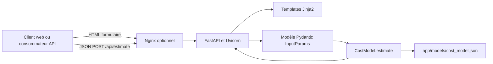

# Architecture technique de Thermocost

> **Statut :** photographie de l’implémentation présente dans le dépôt, complétée par des recommandations.  
> **Date de rédaction :** 14 octobre 2026.  
> **Public :** direction produit, responsables techniques et parties prenantes du déploiement.

## 1. Synthèse exécutive

Thermocost est une application web monolithique qui estime le coût d’installation d’une pompe à chaleur. Une application FastAPI reçoit les réponses du formulaire ou une requête API, valide les entrées avec Pydantic, applique une formule de tarification codée en Python et retourne un résultat HT/TTC. Les règles tarifaires et la définition du formulaire sont également présentes dans un fichier JSON local.

L’application ne comporte pas de base de données : les estimations ne sont pas conservées et le JSON local constitue la configuration tarifaire d’exécution. Le déploiement prévu s’appuie sur Docker Compose sur un serveur Debian chez OVH, avec Nginx optionnel et un workflow GitHub Actions.

**Évaluation produit :** cette architecture convient à un outil d’estimation simple et sans compte utilisateur. Avant de considérer le configurateur tarifaire ou le déploiement automatique comme des fonctions opérationnelles, il faut traiter des écarts vérifiés : protection insuffisante de `/config`, impossibilité d’écrire dans le JSON avec le montage Compose actuel en lecture seule, divergence entre les règles tarifaires documentées dans le JSON et le calcul appliqué, et incohérences dans le workflow de déploiement.

## 2. Périmètre et contexte

### Fonctionnalités présentes

- Présenter un formulaire d’estimation en français.
- Calculer et afficher des montants estimatifs HT et TTC, avec des détails de calcul.
- Exposer une route JSON `POST /api/estimate` en complément du parcours web.
- Afficher une interface de consultation et de modification de la configuration à `/config`.
- Exécuter le service dans un conteneur Docker et vérifier sa disponibilité sur `/`.

### Hors périmètre constaté

- Comptes clients, authentification générale, devis ou historique d’estimations.
- Persistance des demandes, des résultats ou des utilisateurs.
- Paiement, prise de rendez-vous, CRM ou intégration à un outil commercial.
- API versionnée ou contrat public documenté.

## 3. Vue logique

Nginx est décrit comme un proxy facultatif dans les fichiers de déploiement. Le conteneur publie directement le port 8000 ; le service ne dépend donc pas de Nginx pour fonctionner.

## 4. Composants et responsabilités

| Composant | Responsabilité observée |
|---|---|
| `app/main.py` | Crée l’application FastAPI, sert les pages, transforme les champs du formulaire, appelle la validation et le calcul, expose `/api/estimate` et implémente `/config`. |
| `app/templates/index.html` | Affiche le formulaire et les résultats côté serveur avec Jinja2. Les options sont fournies par le JSON de configuration. |
| `app/templates/config.html` | Affiche la connexion par code puis un éditeur de texte JSON. |
| `app/models/cost_model.py` | Charge le JSON au démarrage du module, déclare les champs d’entrée Pydantic et calcule l’estimation. |
| `app/models/cost_model.json` | Définit les champs affichés, les options, les tarifs, les coefficients, la TVA et une description textuelle de la formule. |
| Docker / Compose | Construit l’image Python 3.12, lance Uvicorn et publie le port 8000. Compose monte le dossier `app` en lecture seule. |
| GitHub Actions | Construit une image sur un push vers `main`, puis exécute une étape de déploiement SSH sur le serveur OVH. |
| Nginx | Proxy inverse facultatif devant `127.0.0.1:8000`. La configuration HTTPS est fournie sous forme de bloc commenté. |

## 5. Parcours de données

### Estimation depuis le navigateur

1. `GET /` charge la définition des champs depuis le module de calcul et produit le formulaire HTML.
2. Le navigateur soumet les valeurs à `POST /estimate`.
3. FastAPI convertit les cases à cocher et champs du formulaire en données, puis Pydantic construit `InputParams`.
4. `CostModel.estimate` applique les tarifs et coefficients en mémoire.
5. FastAPI rend de nouveau la page avec les résultats ou les erreurs de validation.

### Estimation par API

`POST /api/estimate` accepte un objet compatible avec `InputParams` et renvoie directement le résultat sérialisé. Cette route partage le même calcul que le parcours web.

### Calcul constaté

Le calcul part du tarif au mètre carré selon l’usage, corrige la surface selon l’isolation et la zone climatique, puis applique les coefficients logement, accès, émetteurs et, pour l’air-air, nombre de pièces. Un coût ECS forfaitaire et par personne peut être ajouté. Le résultat HT est majoré par le taux de TVA standard pour obtenir le TTC. Les montants sont arrondis à deux décimales et le résultat inclut certains paramètres de calcul.

Le code applique systématiquement le taux `standard` (20 %). Le taux `renovation_eligible` (5,5 %) et les conditions associées à la rénovation ne sont pas appliqués. La fourchette de +/- 15 % suggérée dans le JSON n’est pas affichée par le parcours actuel.

## 6. Données et configuration

| Donnée | Emplacement actuel | Persistance |
|---|---|---|
| Tarifs, coefficients, champs et options | `app/models/cost_model.json` | Fichier local inclus au code et à l’image ; pas de stockage de configuration externe. |
| Entrées d’une estimation | Requête HTTP | Non persistées par l’application. |
| Résultat d’une estimation | Réponse HTML ou JSON | Non persisté. |
| Secrets de déploiement SSH | Secrets GitHub Actions (`OVH_SSH_KEY`, `OVH_HOST`, `OVH_USER`) | Gérés par GitHub Actions selon le guide de déploiement. |

Le JSON contient à la fois les options du formulaire et des règles tarifaires. Toutefois, les champs Pydantic et la formule de calcul sont codés en Python. Modifier uniquement le JSON ne permet donc pas de modifier librement les paramètres acceptés ou le comportement du calcul.

## 7. Déploiement et exploitation

### Environnements décrits

- **Développement :** environnement virtuel Python, installation via `requirements.txt`, lancement avec Uvicorn sur le port 8000.
- **Conteneur :** image multi-stage basée sur `python:3.12-slim`, dépendances Python installées dans l’étape de construction, application lancée par Uvicorn.
- **Production visée :** serveur Debian chez OVH, Docker Compose et Nginx optionnel. HTTPS est recommandé, mais sa configuration n’est pas activée par défaut.
- **Publication :** workflow déclenché sur push vers `main` ou manuellement. L’image est construite sur GitHub Actions puis une commande SSH intervient sur OVH.

### Vérifications de santé

Le conteneur et Compose vérifient `GET /`, ce qui correspond à une route existante. Le fichier Nginx contient également un emplacement `/health`, mais aucune route `/health` n’est déclarée dans l’application ; cette URL répond donc actuellement comme une route inconnue.

## 8. Sécurité et risques opérationnels constatés

| Priorité | Constat vérifié | Conséquence possible |
|---|---|---|
| Critique | Le code d’accès de `/config` est la chaîne fixe `jeanmarc` dans `app/main.py`. Il n’y a pas de mécanisme de session ou d’authentification dédié. | Toute personne connaissant ou découvrant ce code peut consulter et modifier les règles tarifaires lorsque l’interface est accessible. Ce code doit être considéré comme compromis. |
| Élevée | Compose monte `./app` vers `/app/app` avec l’option `:ro`, alors que `/config` tente d’écrire dans `app/models/cost_model.json`. | La sauvegarde depuis l’interface de configuration échoue dans l’environnement Compose documenté. |
| Élevée | Le workflow charge l’image construite sur le runner GitHub, mais ne la copie pas vers le serveur. La commande distante tente de charger `thermocost-image.tar`, chemin qui n’est pas transféré par les étapes présentes. Compose est par ailleurs configuré avec `build: .`. | Le déploiement ne suit pas de façon fiable le chemin d’image annoncé ; le résultat dépend du comportement de la suite de commandes sur le serveur et peut reconstruire le code localement. |
| Élevée | Le schéma Pydantic ne reprend pas toutes les contraintes du formulaire JSON : par exemple, la surface est limitée à `>= 0` côté serveur, alors que le formulaire annonce 20 à 400. | Le navigateur et l’API n’imposent pas les mêmes limites ; une requête API peut contourner les limites d’interface. |
| Moyenne | Le JSON décrit un taux réduit et une fourchette d’estimation, mais le calcul utilise systématiquement la TVA standard et ne présente pas la fourchette. | Risque d’écart entre les règles métier attendues, le résultat communiqué et les éléments de configuration. La conformité fiscale doit être confirmée par un responsable compétent. |
| Moyenne | Les configurations sauvegardées via `/config` sont écrites localement et ne sont pas enregistrées dans Git ni dans un stockage partagé. | Une modification peut être perdue lors d’une reconstruction ou d’un remplacement du conteneur ; aucun historique ou processus de validation n’est prévu. |
| Moyenne | Nginx transmet `/health` à une route applicative inexistante. | Un outil externe qui utilise cette URL peut interpréter le service comme indisponible. |

Ces constats proviennent de la lecture du code et des configurations présentes ; ils ne constituent pas une vérification d’intrusion ni un test du serveur en production.

## 9. Recommandations produit et techniques

### À traiter avant ouverture publique de l’administration

1. Supprimer le code d’accès en dur. Si l’édition en ligne est conservée, mettre en place une authentification adaptée, des secrets gérés hors du dépôt, une protection contre les requêtes intersites et un journal des modifications. Sinon, désactiver `/config` et gérer les tarifs par une publication contrôlée.
2. Définir une source de vérité persistante pour les tarifs. Ajouter validation de schéma, sauvegarde, versionnement et retour arrière. Éviter l’écriture directe dans un fichier de l’image applicative.
3. Aligner le schéma serveur, le formulaire, l’API et les règles métier ; préciser les décisions fiscales et la sémantique de l’estimation avant publication des montants.

### À traiter avant de fiabiliser la production

4. Corriger le contrat de déploiement : choisir explicitement entre transfert d’une image immuable et construction à partir du code sur le serveur. Vérifier les chemins et tags, rendre l’opération échouante en cas d’erreur et conserver une possibilité de retour à la version précédente.
5. Déclarer un endpoint de santé dédié ou supprimer la référence Nginx à `/health`, puis vérifier la santé applicative après chaque publication.
6. Ajouter des tests automatisés sur les règles tarifaires, les cas limites, la validation des champs et les réponses de l’API. La formule devrait avoir des exemples métier de référence approuvés.

### Évolutions à décider selon l’usage

7. Si le produit doit reprendre contact avec les prospects ou suivre les conversions, définir le consentement, les données collectées, la durée de conservation et les intégrations avant d’ajouter une persistance.
8. Ajouter journalisation structurée, suivi des erreurs et métriques de disponibilité adaptés aux objectifs de service retenus.
9. Décider si les résultats doivent rester des montants ponctuels ou devenir des fourchettes accompagnées d’hypothèses explicites, comme le suggère la configuration actuelle.

## 10. Décisions produit ouvertes

- L’estimation doit-elle afficher un montant unique ou une fourchette indicative ?
- Quels critères déterminent le taux de TVA applicable, et qui valide ces règles ?
- La configuration tarifaire doit-elle être modifiable en production ? Par qui, avec quelle approbation et quel historique ?
- Les demandes doivent-elles être anonymes et éphémères, ou enregistrées pour permettre un suivi commercial ?
- Quel niveau de disponibilité, de délai de rétablissement et de traçabilité est attendu pour le service ?

## 11. Références du dépôt

- Application et routes : `app/main.py`
- Modèles de validation et calcul : `app/models/cost_model.py`
- Configuration tarifaire : `app/models/cost_model.json`
- Dépendances : `requirements.txt`
- Image et lancement du conteneur : `Dockerfile`
- Exécution locale en conteneur : `docker-compose.yml`
- Publication automatisée : `.github/workflows/deploy.yml`
- Proxy inverse : `deploy/nginx.conf`
- Guide de mise en production : `deploy/DEPLOYMENT.md`